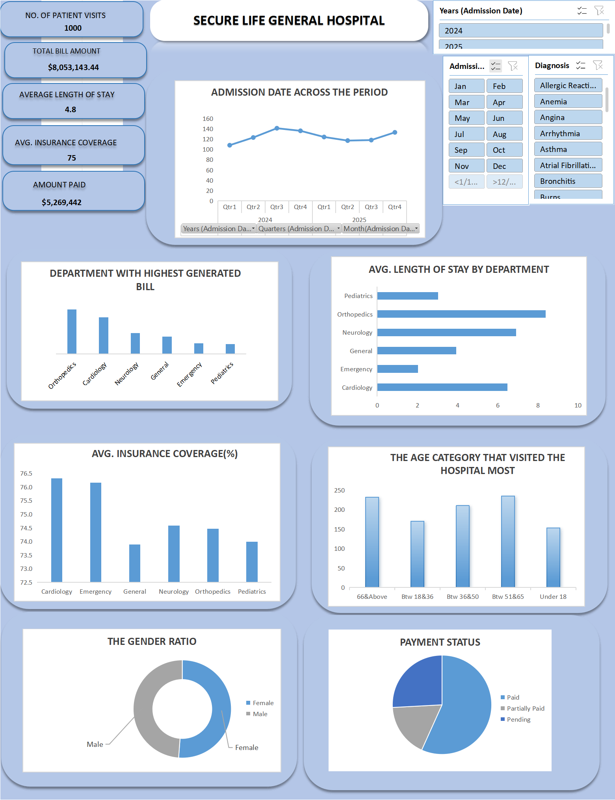

# Secure Life General Hospital an Excel Based Healthcare Analytics
## Project Introduction

This project focuses on analyzing hospital patient records using Microsoft Excel to uncover meaningful insights into patient demographics, hospital admissions, departmental performance, length of hospital stays, insurance coverage, and payment patterns.
The project demonstrates how Excel can be used to transform raw healthcare data into meaningful insights through data cleaning, calculated columns, Pivot Tables, data visualization, and interactive dashboard development.

## Project Objectives
The primary objectives of this analysis were to:

- Analyze patient demographics, including age and gender distribution.
- Evaluate patient admissions across different hospital departments.
- Identify departments with the highest patient volumes and billing amounts.
- Examine the average length of hospital stays across departments.
- Assess insurance coverage across departments.
- Analyze payment patterns and financial performance.
- Track hospital admission trends over time.

## Tools & Techniques

**Tool Used:** Microsoft Excel

**Techniques Applied:**
- Data cleaning and preparation
- Excel formulas and calculated columns
- IF/IFS functions
- Date calculations
- Pivot Tables and Pivot Charts
- GETPIVOTDATA function
- Data visualization
- Interactive dashboard development

## Dataset Description

The dataset contains **1,000 patient records** and 14 columns, covering the following information:

| Category | Variables |
|---|---|
| Patient Information | Patient ID, Patient Name, Age, Gender |
| Admission Details | Admission Date, Discharge Date |
| Clinical Information | Department, Diagnosis |
| Financial Information | Total Bill Amount, Insurance Coverage %, Payment Status |
| Calculated Fields | Age Category, Length of Stay, Amount Paid |

## Data Preparation & Analysis

The following steps were undertaken:
1. **Data Exploration:** Examined the dataset to understand its structure, variables, and contents.
2. **Data Preparation:** Organized the dataset and prepared additional calculated fields for analysis.
3. **Calculated Columns:** Created Age Category, Length of Stay, and Amount Paid to support further analysis.
4. **Pivot Table Analysis:** Used Pivot Tables to summarize patient records and investigate trends across different categories.
5. **Data Visualization:** 
 Consolidated key performance indicators (KPIs) and visualizations into an Excel dashboard.

## Key Findings & Insights

### 1. Patient Distribution by Department
- General recorded the highest number of patients, with 252 visits.
- Emergency followed with 190 patients.
- Neurology recorded the lowest patient volume, with 94 visits.

### 2. Departmental Billing Performance
- Orthopedics generated the highest total billing amount of 2,553,862.32.
- Cardiology followed with 2,095,437.97.
- Pediatrics recorded the lowest total billing amount of 572,987.96.

### 3. Average Length of Stay
- Orthopedics recorded the longest average hospital stay of approximately 8.38 days.
- Neurology followed with approximately 6.91 days.
- Emergency recorded the shortest average stay of approximately 2.03 days.

### 4. Patient Demographics
- Female patients accounted for 51.2% of the records.
- Male patients accounted for 48.8%.
- Patients aged 51–65 formed the largest age category, representing 235 records.

### 5. Admission Trends
Patient admissions were analyzed across quarters for 2024 and 2025 to identify changes in hospital activity over time.

### 6. Payment Analysis
Payment statuses were examined across three categories:
- Paid
- Pending
- Partially Paid

This provided an overview of the hospital's payment patterns and revenue collection.

## Dashboard Preview

The Excel dashboard presents key hospital performance indicators and visualizations covering:

- Patient visits
- Departmental performance
- Average length of stay
- Insurance coverage
- Patient demographics
- Payment status
- Admission trends

## Project Deliverables

- Excel workbook containing the dataset, Pivot Tables, and dashboard.
- Dashboard visual – A visual representation of the completed Excel dashboard.

## Skills Demonstrated

- Microsoft Excel
- Data Cleaning and Preparation
- Data Analysis
- Pivot Table Reporting
- KPI Development
- Data Visualization
- Dashboard Design
- Healthcare Data Analysis
- Analytical Thinking and Interpretation

## Conclusion

This project demonstrates the application of Microsoft Excel in healthcare data analysis and reporting. By transforming patient records into structured summaries and visual insights, the analysis provides a clearer understanding of hospital operations, patient demographics, departmental performance, and financial trends.

It also highlights the importance of data-driven decision-making in healthcare management.

---

**Author:** Leticia Lardje Kwamifio  
**Project Category:** Healthcare Data Analytics  
**Tool:** Microsoft ExcelHealthcare data analysis project using Microsoft Excel to explore patient demographics, hospital admissions, departmental performance, length of stay, and payment trends through Pivot Tables and an interactive dashboard.
